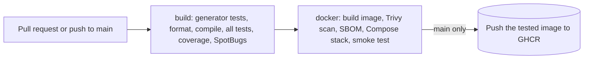

# Notes for the assessor

These notes sum up what was delivered for the store assessment: the four tasks, the CI/CD bonus,
the features added along the way, the design decisions and assumptions behind them, the problems
found in the original code and how each was fixed, and how the work was tested. `README.md` is
kept exactly as it was handed over. The detail behind every point is in `docs/`, listed at the
end.

## At a glance

| Area | Result |
|---|---|
| README tasks 1 to 4 | Delivered, covered by unit, slice, integration and Cucumber tests, and described in `OpenAPI.yaml` |
| Bonus: a CI pipeline that delivers a Docker image | GitHub Actions builds and tests the code, then scans, smoke-tests and publishes the image |
| Tests | 882 automated tests, all passing, with 100% line coverage of the counted code |
| Problems in the original code | 17 found and fixed (listed below) |
| Way of working | Worked as a team would on a production system: after the initial import, every change went through a pull request (80 merged), approved by a second GitHub account acting as the reviewer |

## How to run it

You need Docker, and a JDK 17 to 24 to run Gradle: Gradle 8.14 starts on Java 25, but
`spotlessCheck` fails there (`docs/DESIGN.md`, "Prerequisites").

```shell
# The README way: PostgreSQL 16.2 on localhost:5433 with admin:admin, then
./gradlew bootRun

# The production-shaped stack: PostgreSQL, a one-off migration job and the service
docker compose up --build

# The pipeline's Gradle checks: formatting, compilation, the unit, slice, integration and
# Cucumber tests, the coverage gate and SpotBugs (Docker must be running, for Testcontainers)
./gradlew build

# The pipeline's image checks: start the stack in the background, then run the smoke test
docker compose up -d --build && sh scripts/smoke-test.sh http://localhost:8080 http://localhost:8081 compose
```

The API is on http://localhost:8080. Health and metrics are on a separate port,
http://localhost:8081 (for example `/actuator/health`). A few requests to try against the sample
data:

```shell
curl -s localhost:8080/order/1
curl -s 'localhost:8080/customer?name=onne'
curl -s localhost:8080/products/2
curl -s 'localhost:8080/order?customerId=1&size=5'
```

## What was delivered for each task

### Task 1: find an order by id
- `GET /order/{id}` returns the order with its customer and its products.
- An unknown id is a 404 problem detail (`"code": "not_found"`). A non-numeric id is a 400.
- It costs one database statement. The result is then cached for 60 seconds, because an order
  never changes.

### Task 2: find customers by part of a word in their name
- `GET /customer?name=onne` returns the customers whose name contains `onne` within one of its
  words, ignoring case.
- The README asks for "a substring of one of the words", so the query must be a single word.
  A query with a space in it is a 400. `%` and `_` are matched as plain characters, not as SQL
  wildcards.
- Results are paged like every other list. A trigram index (`pg_trgm`) lets PostgreSQL use an
  index for the search on large tables.

### Task 3: make the GET endpoints fast over a slow network
The database is far from the service, so every round trip to it is expensive. The original list
endpoints sent 11 statements and returned the whole table on every call.

| Request | Before | After |
|---|---|---|
| `GET /order` | 11 statements, all 10,000 orders, 950,440 bytes | 3 statements, a page of 20, 3,795 bytes (968 gzipped) |
| `GET /customer` | 11 statements, 100 customers with all 10,000 orders, 503,458 bytes | 3 statements, a page of 20 customers with their newest 20 orders, 21,343 bytes (4,104 gzipped) |

At 30 ms per round trip a page now waits about 120 ms on the network instead of at least 330 ms,
and the number of round trips and the size of a response no longer grow with the table. The count
behind an offset page still reads the table; cursor paging skips it. The main changes:
- Every list is paged (20 by default, 100 at most). Cursor paging (`?after=`) serves long walks
  without the cost of deep offsets.
- A full page costs 3 statements: the page, its count, and the children of exactly that page. A
  cursor page skips the count and costs 2. Nothing is lazy-loaded, so there is no N+1 problem.
- Indexes on the foreign keys, on the name search and on every sortable column.
- Open-in-view is switched off, and list pages read plain rows instead of entities.
- Responses are compressed, `GET`s carry ETags so a repeat can be answered `304 Not Modified`,
  and single orders and products are cached in memory for a short time.
- `QueryCountIT` pins the statement count of every `GET` exactly, so a change that adds a query
  to a read fails the build.

`docs/PERFORMANCE.md` has the measurements, the query plans and what was deliberately not done.

### Task 4: products
- `POST /products` creates a product: `{"description": "..."}`.
- `GET /products` (paged) and `GET /products/{id}` return each product with the ids of the orders
  that contain it. To keep a response bounded for a popular product, they carry the newest 20 ids
  and `orderCount`, the total; `GET /order?productId=` pages through the complete list.
- `POST /order` takes `productIds`. An order needs 1 to 100 different products that exist.
- `GET /order` and `GET /order/{id}` include the products of each order.
- Orders and products are linked many-to-many through the `order_product` table, indexed in both
  directions.
- The products part of the original `OpenAPI.yaml` had errors (a single object instead of a list,
  a string id, an id in the request body) and was corrected.

### Bonus: a CI pipeline that delivers a Docker image
Described under "The CI/CD pipeline" below.

## Features added beyond the tasks
- **Lists:** paging and sorting with a fixed list of sortable fields, cursor paging, and filters
  on `GET /order` by `customerId` or `productId`. `GET /customer/{id}` was added as well.
- **One error format:** every error the service returns is an RFC 7807 problem detail with a
  stable `code` field (19 codes, listed in `docs/DESIGN.md`). A request so malformed that Tomcat
  rejects it before it reaches the service, such as an undecodable path, gets Tomcat's own 400
  (`docs/DESIGN.md`, "Requests Tomcat rejects itself").
- **Safe retries:** an optional `Idempotency-Key` header on every `POST`, so a client can resend
  a request after a timeout without creating a duplicate (ADR 0010).
- **Strict input:** unknown JSON fields, a client-supplied `id`, wrong JSON types and bodies over
  64 KiB are all rejected with a 400 or 413.
- **Operations:** health, readiness and liveness probes and Prometheus metrics on port 8081;
  JSON logs in the container with a request id on every line of a request; an access log; a
  graceful shutdown that lets requests in flight finish.
- **Resilience:** every database call the service makes while serving requests has a time limit;
  the one-off migration job lifts the statement and socket limits, since an index build can take
  longer. A lost or stuck database answers 503 with `Retry-After` instead of hanging. The one
  exception is a `POST` whose session the database ends at commit, which is a 500.
- **Safe configuration:** the deployable jar has no default credentials, and loads sample data
  only when the `seed` context is chosen. In the Compose stack, migrations run as a separate job
  and the service connects as a least-privilege database role: it can read and insert, and can
  update or delete only its own idempotency records.
- **Hardened image:** distroless Java 17, a non-root user, and a read-only filesystem with all
  Linux capabilities dropped in Compose.

## Design decisions and ADRs

**How the ADRs were written.** Each decision that shapes the code, and that a reviewer could
reasonably question, is recorded as an architecture decision record (ADR) in `docs/adr/`. Every
ADR has the same four parts:
- **Status:** accepted, amended or superseded by a later ADR, or time-boxed with an expiry date.
- **Context:** the problem and the forces at play, with measurements where they exist.
- **Decision:** what was chosen, stated precisely enough to check against the code.
- **Consequences:** what the decision costs and what it rules out.

Seven of the ten ADRs were written in the pull request that made the change. The other three record
decisions already in the code: ADRs 0001 and 0002 were written in #6, and ADR 0009 in #83. An ADR is
revised whenever the code it describes changes, so it stays true: ADR 0006 replaced the list-page
fetch strategy of ADR 0003, and ADR 0004 expires on 2027-01-31 unless it is renewed.

| ADR | Decision | Why |
|---|---|---|
| 0001 | Controller, service and repository layers, with request and response records; entities never reach the controllers | Keeps HTTP, use cases and persistence apart, and stops a request body from writing an entity |
| 0002 | Authentication is left to a gateway in front of the service, with no permit-all Spring Security | A security filter chain that lets everything through protects nothing; OAuth2 in the service is issue #70 |
| 0003 | Every list is paged (20 by default, 100 at most), with cursor paging and bounded nested lists | Bounds every response, and every page to at most 3 statements; round trips to the remote database dominate latency |
| 0004 | Two Spring Framework 6 advisories are accepted until 2027-01-31 | Neither vulnerable code path is reachable here, and the fix needs Spring Boot 4 (issue #57) |
| 0005 | Ids come from sequences in blocks of 50 (`pooled-lo`) | `IDENTITY` made Hibernate run every insert immediately to learn its id, so inserts could never be batched |
| 0006 | List pages are built from constructor projections, and only whitelisted fields can be sorted | Paging entities loaded thousands of them per page. Without the whitelist an unknown sort is a 500, and `sort=customer.name` orders through an unindexed join |
| 0007 | `GET`s carry ETags and answer `304`; single orders and products are cached for 60 seconds | Saves transfer and round trips while keeping stale data short-lived |
| 0008 | Migrations run as a separate job, the service uses a least-privilege role, readiness includes the database, shutdown drains requests, and every request has an id | How the service behaves in production, not only on a laptop |
| 0009 | From changeset 8 on, a new index on an existing table is built with `CREATE INDEX CONCURRENTLY`; changesets 3, 4 and 7 keep their plain builds | Writes keep flowing while an index builds on a live table |
| 0010 | An optional `Idempotency-Key` on the three `POST`s, stored in its own table | A client can retry a `POST` after a timeout without creating a duplicate |

Smaller decisions are recorded in `docs/ASSUMPTIONS.md`: one problem-detail format with a stable
`code` for every error Spring MVC handles, exact JSON types with no coercion, an OpenAPI contract
that is versioned and enforced by a test, and the reserved table name `order` kept as it is.

## Assumptions we made

**How they were made.** The README leaves the tasks deliberately vague and asks for assumptions
that can be defended. Each was made the same way:
1. Read the README literally where it is specific. Where that would make a response unbounded,
   bound it, keep an endpoint for the full list, and say why.
2. Where it is vague, choose what is safest for a service that is already in production.
3. Record the assumption and its reason in `docs/ASSUMPTIONS.md`, and pin it with a test where it is
   behaviour.
4. Open an issue with a deadline for the two large deferrals (#57 and #70). Record the smaller ones
   in `docs/ASSUMPTIONS.md`.

**The main ones:**
- **Production:** the service is already live with real data and real clients. Schema changes are
  Liquibase changesets that keep the data a database already holds, contract changes are versioned
  with migration notes, and the deployable jar has no sample credentials and loads sample data only
  under the `seed` context.
- **Team workflow:** the work is done as a team would do it on a production system. Every change
  goes through a pull request, and a second GitHub account acts as the reviewer account that
  approves it before it merges.
- **Security:** callers are authenticated by a gateway in front of the service (ADR 0002). Adding
  OAuth2 to the service itself is issue #70.
- **Task 2:** "a substring of one of the words in their name" means a single-word query, matched
  anywhere inside a word of the name, ignoring case. A query with whitespace is a 400.
- **Task 3:** with a remote, high-latency database, round trips matter more than rows, so the work
  counts statements per request.
- **Task 4:** "a list of the order IDs" for a product carries the newest 20 ids and `orderCount`,
  so a popular product cannot produce an unbounded response; `GET /order?productId=` pages through
  the full list. "All products" is served page by page: `size=100` returns the whole sample
  catalogue, and cursor paging walks a catalogue of any size.
- **Task 4:** an order needs at least one product when it is created. Orders that existed before
  products were introduced may have none, and the contract says so.
- **Paths:** `/customer` and `/order` stay singular, as in the original README; `/products` is
  plural because the task names it so.

## Problems found in the original code and how they were fixed

The README says bad choices were made on purpose. These are the ones found, what they caused and
what was done. Each fix in the service code is pinned by a test that fails if the problem comes
back.

| # | Problem in the original code | What it caused | Fix |
|---|---|---|---|
| 1 | The seed inserted fixed ids but left the id sequences at 1 | The first `POST /customer` or `POST /order` failed with a 500 (duplicate key) | A migration moves each sequence past the highest id. Ids now come from sequences in blocks of 50, so inserts can be batched |
| 2 | Controllers took JPA entities as the request body | `POST /customer` with `"id": 5` silently overwrote customer 5, and nested orders were saved through a cascade | Request records with no id field. Unknown fields are a 400. The cascade is gone |
| 3 | Controllers called the repositories directly, with no transaction around the request | The DTO mapping loaded lazy collections after the repository's own transaction had ended, which only worked because open-in-view kept the session open | A service layer whose transactions cover the reads and the mapping, returning DTOs. Open-in-view is off |
| 4 | No validation and no error handling | Bad input produced a 500 instead of a clear 400 | Bean Validation on the requests and one exception handler that returns problem details |
| 5 | `GET /order` and `GET /customer` returned whole tables | 10,000 rows and 11 statements per call (task 3) | Paging, cursor paging and a fixed number of statements per page |
| 6 | No index on `order.customer_id` | Every lookup of a customer's orders scanned the whole table | Index added |
| 7 | Lombok `@Data` on two entities that point at each other | `toString` and `hashCode` walked the lazy collections and could recurse | Id-based `equals`, a constant `hashCode`, an id-only `toString` and no setters |
| 8 | Entity columns nullable while the schema says `NOT NULL` | The mapping disagreed with the database | Mapping corrected to match the schema |
| 9 | `admin:admin` hard-coded in the main configuration | Sample credentials shipped in every build | No credential defaults in the deployable jar. The README defaults live in a `local` profile that `bootRun` uses and the jar leaves out |
| 10 | Sample data loaded in every environment | A production database would receive fake customers | Sample data loads only under the `seed` context |
| 11 | No time limit on any database call | A stalled connection could hold a request thread forever | Statement, socket and transaction timeouts. Failures answer 503 with `Retry-After` |
| 12 | `OpenAPI.yaml` had a typo (`descriptioon`), wrong shapes, ids in request bodies and no error responses | A client generated from it would be wrong | Corrected, versioned, and checked against the running service by a contract test |
| 13 | Tests: a misspelled `OrderContollerTests`, repositories mocked inside controller tests, a stray `;` and an unused stub | Tests that would not catch regressions | Renamed and rewritten. Controller tests mock the service layer only. Unit, integration and Cucumber tests and a smoke test were added |
| 14 | Build: an unused plugin, wrong dependency scopes, a duplicate dependency, no coverage gate, and Spring Boot 3.4.2 and Gradle 8.11.1 out of date | A noisier build and known vulnerabilities | Cleaned up, with a coverage gate. Spring Boot 3.5.16, the last 3.5 release (4.1 is issue #57), and Gradle 8.14.6. Dependabot proposes minor and patch updates |
| 15 | A misnamed mapper method and wildcard imports | Harder to read | Renamed. Wildcard imports replaced with explicit ones |
| 16 | `utils/generateData.js` did not escape quotes and used an unseeded random | A regenerated file could fail to load (`O'Keefe`), and the data could not be reproduced | Quotes escaped and the generator seeded. Its tests, which pin the seeding, run in CI |
| 17 | No Docker image, no CI, no health checks and no metrics | Nothing to deploy or to monitor | A Dockerfile, a Compose stack, the CI pipeline, actuator probes and Prometheus metrics |

Kept on purpose: the table name `order` is a reserved word in SQL. Renaming it would mean
migrating the table, its sequence, its foreign key and the join table for no functional gain, so it
stays quoted. `docs/ASSUMPTIONS.md` ("Defects found in the original code and what was done") has
the full list with the original line numbers.

Problems found along the way:
- The new image scan found critical vulnerabilities in the original Spring Boot line. Spring Boot
  was upgraded and Tomcat raised to a patched version. Two Spring Framework 6 advisories have no fix
  on that line; they are accepted until 2027-01-31 (ADR 0004), and the upgrade that removes them
  is issue #57.
- A search word containing a NUL character reached PostgreSQL and came back as a 409. Control
  characters are now a 400 before any query runs.
- While building idempotency keys, a race was found where a request taken over after the stale
  window could still create its record. A claim token now makes that request roll back with a 409.

## How it was tested

### Approach
- **Tests first.** New behaviour started with a test that was seen to fail, then the code that
  makes it pass.
- **A real database.** Integration tests run against PostgreSQL 16.2 in Docker (Testcontainers),
  never an in-memory substitute, so the SQL, the indexes and the migrations run on the same
  database engine and version as in production.
- **One database, one shared context.** A single PostgreSQL container serves the whole run, and
  the integration tests and Cucumber scenarios share one Spring context. The suite takes about a
  minute on a laptop.

### The test levels

| Level | Tool | What it checks | Tests |
|---|---|---|---|
| Unit | JUnit 5, Mockito | Services, mappers, validation rules and configuration, each on its own | 209 |
| Web slice | `@WebMvcTest` | The HTTP layer alone: status codes, JSON shape, validation and error bodies | 211 |
| Integration | Spring Boot with Testcontainers PostgreSQL | Real requests through the whole service into a real database: migrations, indexes, statement counts, timeouts, shutdown and the API contract | 383 |
| Acceptance | Cucumber (Gherkin) | The API's behaviour, written as plain-language scenarios | 79 |
| Smoke | `scripts/smoke-test.sh` | The real Docker image in the running Compose stack | 1 script, run by the CI `docker` job and locally, not by `./gradlew build` |

Three integration tests do special jobs:
- `QueryCountIT` counts the SQL statements each request sends. Every `GET` is pinned exactly, which
  keeps the task 3 gains from wearing away. A `POST` is pinned within one statement, because the
  request that fetches the next block of 50 ids sends one more.
- `OpenApiContractIT` checks real requests and responses against `OpenAPI.yaml`, so a response
  it exercises that drifts from the published contract fails the build.
- `MigrationIT` checks the migrations, the sequences, and that each index can serve the query it
  was built for.

### Quality gates
`./gradlew build` fails on any of these:
- a failing unit, slice, integration or Cucumber test;
- a formatting difference (Spotless with Palantir Java Format);
- a SpotBugs finding;
- line coverage below 80% (JaCoCo). Coverage is currently 100% of lines. The `mapper` package,
  which is mostly generated by MapStruct, and the main class are not counted.

## The Gherkin (Cucumber) scenarios

Gherkin is a plain-language format for describing behaviour. Each scenario says what is done
(`When`) and what must follow (`Then`), so it can be read without knowing Java.

- **Where they are:** `src/test/resources/features/`: `customer.feature` (28 scenarios),
  `order.feature` (41) and `product.feature` (10).
- **What one looks like**, from `order.feature`:

  ```gherkin
  Scenario: Fetching an unknown order is a not found
    When I request order 999999
    Then the response status is 404
    And the response problem code is "not_found"
    And the response problem detail is "Order with id 999999 was not found"
  ```

- **How they run:**
  1. `CucumberIT` is a JUnit 5 suite, so the scenarios run inside `./gradlew build` with every
     other test, locally and in CI.
  2. `CucumberSpringConfiguration` starts the whole application on a random port, against the same
     PostgreSQL container the integration tests use.
  3. `StoreApiSteps` holds the step definitions. Each `When` or `Then` line maps to a Java method
     that sends a real HTTP request (`TestRestTemplate`) or checks the response.
- **What they cover:** the main path and the failure paths of every task: creating and fetching
  customers, orders and products, the name search, paging and cursors, the 404s and 400s,
  idempotent retries, and a database that fails in the middle of a request (503).

## The CI/CD pipeline

GitHub Actions runs `.github/workflows/ci.yml` on every pull request and every push to `main`. It
has two jobs, and the second starts only when the first passes.



**The `build` job**
1. Tests the sample-data generator in `utils` (`npm ci && npm test`).
2. Runs `./gradlew spotlessCheck build test --rerun`: formatting, compilation, the unit, slice,
   integration and Cucumber tests, the coverage gate and SpotBugs.
3. Uploads the test, coverage and SpotBugs reports.

**The `docker` job**
1. Builds the Docker image once.
2. Scans it with Trivy. A fixable critical or high vulnerability fails the job, except two Spring
   Framework advisories accepted in `.trivyignore` until 2027-01-31 (ADR 0004).
3. Records a software bill of materials (SBOM), kept for 90 days.
4. Starts the full Compose stack with that image: PostgreSQL, the migration job and the service.
5. Runs the smoke test: health, real API calls, an idempotent replay, the container hardening and
   the database role's permissions.
6. On `main` only, pushes the exact image that was scanned and smoke-tested to
   `ghcr.io/neeleshrambally/store`, tagged `latest` and `sha-<short commit id>`.

**Getting a change to `main`.** A change is merged once both jobs are green and the reviewer account
has approved the pull request. A ruleset on `main` enforces this and blocks force pushes. Before the
repository went public the free plan offered no rulesets, so the same gate was a procedure, which
has held since #27; a few earlier merges waited for `build` only (`docs/ASSUMPTIONS.md`, "Pull
requests and history"). Dependabot opens weekly update pull requests, which go through the same
pipeline.

**GitLab.** `.gitlab-ci.yml` is an equivalent pipeline for teams on GitLab: build, package, smoke,
scan and publish. There is no GitLab project, so it has never run. It passes GitLab's CI schema,
and `docs/DESIGN.md` ("The GitLab pipeline") lists how it differs from the GitHub one.

**Pulling the delivered image.** The image is public, so no login is needed:

```shell
docker pull ghcr.io/neeleshrambally/store:latest
```

`docs/DESIGN.md` ("Pulling the delivered image") shows how to run it against the Compose database.

## Open follow-ups

| Issue | Why it is open |
|---|---|
| #57 Upgrade to Spring Boot 4.1 | The 3.5 line is out of open-source support, and two Spring Framework 6 advisories are only fixed in Framework 7. Due before 2027-01-31, when their accepted exceptions expire |
| #70 OAuth2 resource-server authentication | Deferred while the service runs behind a gateway (ADR 0002). Planned on the Spring Security line that #57 brings |

## Where to read more

| Document | What it covers |
|---|---|
| `docs/DESIGN.md` | Running, configuring, testing and operating the service; the API, its errors and the pipelines |
| `docs/ASSUMPTIONS.md` | Every judgement call, and the full list of original defects with line numbers |
| `docs/PERFORMANCE.md` | Task 3 in depth: measurements, query plans, indexes and caching |
| `docs/adr/` | Ten architecture decision records |
| `OpenAPI.yaml` | The API contract: contract version 3.1.0, written in OpenAPI 3.0 |
| `utils/README.md` | How to generate more sample data |
